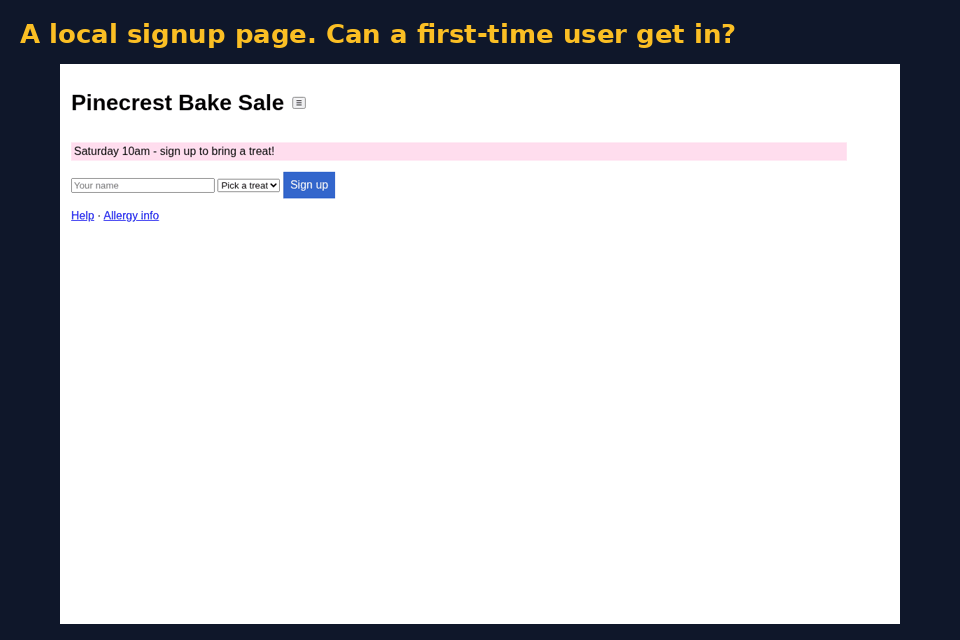
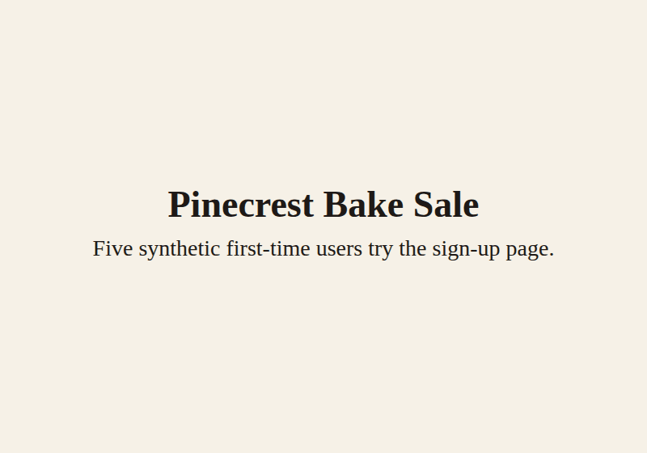

# First-Run Lab

Five synthetic first-time users (a skimmer, a keyboard-only user, a phone user, a screen-reader user and a link checker) walk your **local** web app and report where they get stuck, with a 0–100 score and screenshots.



## 2-minute quickstart

Needs Python 3.9+. From the repo folder:

```bash
python3 -m venv .venv && . .venv/bin/activate
pip install -e .
python -m playwright install chromium
frl run examples/signup.html
frl run examples/signup-fixed.html -o frl-out-fixed --port 8766
frl report frl-out/report.json -o leaderboard.html
```

You'll see the broken signup page score low, with "Sign up" as the top hotspot, while the fixed page scores 100. Open `frl-out/report.html` for the full report and `leaderboard.html` for the leaderboard.

Sample output: [`examples/report-demo.html`](examples/report-demo.html) and [`examples/leaderboard-demo.html`](examples/leaderboard-demo.html). The media is rebuilt with `tools/make_media.py`, which makes the demo GIF from synthetic pages only, and `tools/make_reveal.py SWEEP.json reveal.mp4`. Both OCR-check frames before writing.

## Commands

| Command | What it does |
|---|---|
| `frl run TARGET [-o DIR] [--kind auto\|form\|dashboard]` | Scores one page. TARGET is a local file, a local folder (serves `index.html`) or an `http://127.0.0.1:PORT/` URL. Writes `report.json`, `report.html` and screenshots. |
| `frl sweep ROOT [-o sweep.json] [--hints hints.json]` | Scores every app folder under ROOT, building template apps first and grouping apps that share code. |
| `frl sweep ROOT --isolated APP …` | Starts each app's own backend and scores it inside a Linux user and network namespace that has only loopback, so it can't reach the internet. Needs `unshare`. |
| `frl report JSON [-o leaderboard.html]` | Builds an HTML leaderboard from a sweep or run JSON. |

**Start hints.** To set an app's start or build command, put a `frl-start: <cmd>` or `frl-build: <cmd>` line in its README, or pass a `--hints` JSON file such as `{"app": "python3 server.py", "app:port": 4300, "app:build": "python3 build.py"}`.

**Scoring.** The score is 100 − min(60, 20·blockers) − min(30, 6·majors) − min(10, 2·minors). An app is marked "needs backend" when none of its `/api` calls succeed, and "unreachable" when the landing page doesn't return 200.

**Safety.** Only localhost targets are allowed. Requests to other hosts are blocked, and off-site links are neither checked nor clicked. Reports are scanned for emails, phone numbers and SSNs, and any run whose report contains one is refused. Set `FRL_REDACT=word1,word2` to blank out extra words.

## TypeScript v2

v2 lives in `ts/` and follows `spec/FirstRunLab.tla`. The Python package above is unchanged. From the repo folder, with Node 22:

```bash
cd ts && npm install && npx playwright install chromium
node --import tsx src/cli.ts run ../examples/signup.html --kind form
node --import tsx src/cli.ts gate ../examples/signup-fixed.html --min 80 --kind form
node --import tsx src/cli.ts replay ../runs/demo-bad --fixed ../runs/demo-fixed --gif ../screenshots/demo-ts.gif
```

`npm test` regenerates nothing by itself; CI runs `node tools/gen-statechart.mjs` and fails if `ts/src/statechart.generated.ts` drifts from the TLA+ tables. TLC must accept the model and reject the three mutants (`tools/check-tlc.sh`).

Divergences from v1, including the two intentional bug fixes (closed sections, tab-until-wrap), are in [`spec/DIVERGENCES.md`](spec/DIVERGENCES.md).



## Development

```bash
pip install -e ".[test]" && pytest -q
cd ts && npm test && npm run typecheck
```
